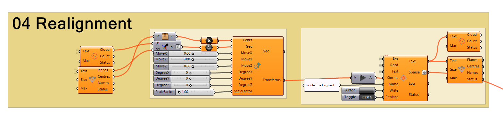
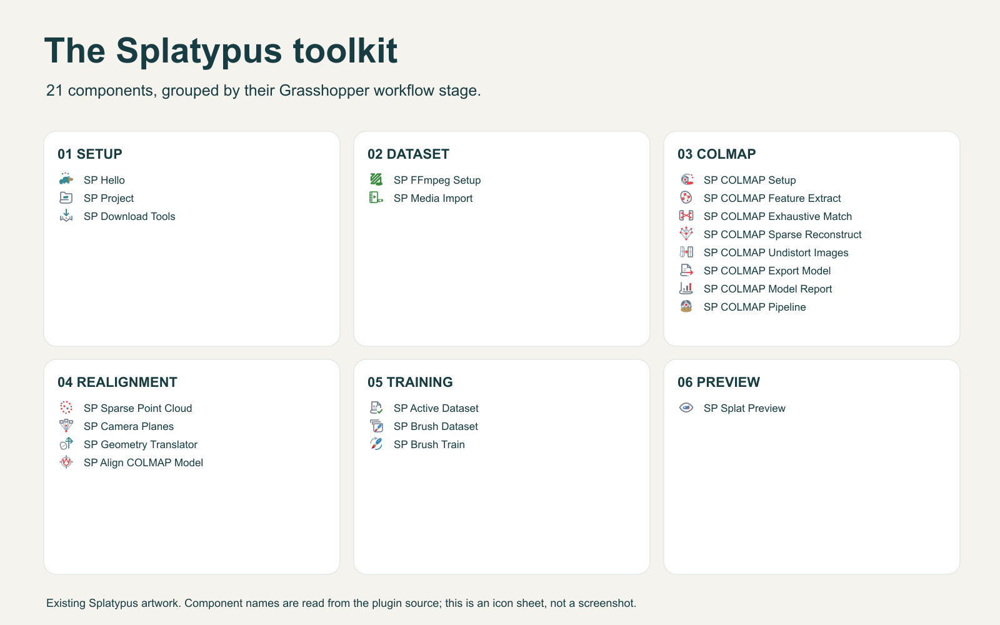

# Splatypus

**Photogrammetry and Gaussian splat training workflows for Grasshopper in Rhino 8.**

[food4Rhino](https://www.food4rhino.com/en/app/splatypus) · [Download 0.1.0](#download-and-install) · [Quick-start PDF](Publication/Splatypus-Quick-Start.pdf) · [Example workflow](Examples/Splatypus_Workflow.gh) · [User guide](Documentation/User-guide.md)

Splatypus brings photographs and video into a connected, local reconstruction and training workflow. It connects **FFmpeg** media import, **COLMAP** camera reconstruction and **Brush** Gaussian splat training through a shared project folder, with progress, logs and cancellation inside Grasshopper.

Developed by **[Zeming Li](https://zeming.li/)**. Free under the **[MIT License](LICENSE.txt)**. Current release: **0.1.0**, published on food4Rhino on **11 October 2026**.

## What you can do

- Import photographs or extract video frames, with image-count estimates.
- Reconstruct cameras and sparse points using individual COLMAP stages or one pipeline.
- Undistort images, inspect camera planes and align a model to Rhino coordinates.
- Prepare a consistent active dataset for Brush, train in the background and export PLY files.
- Inspect exported point centers as colored point clouds in Rhino.

The release contains **21 components**. Its Rhino preview displays colored points; a Gaussian splat viewport renderer, mesh reconstruction and texture-atlas generation are not included in 0.1.0.

## Download and install

| Platform | Manual installation | Local Yak package |
| --- | --- | --- |
| Windows x64 | [Download ZIP](https://github.com/Zemi-jpg/Splatypus/raw/refs/tags/v0.1.0/dist/publication/Splatypus-0.1.0-windows.zip) | [Download Yak](https://github.com/Zemi-jpg/Splatypus/raw/refs/tags/v0.1.0/dist/publication/splatypus-0.1.0-rh8_34-win.yak) |
| macOS | [Download ZIP](https://github.com/Zemi-jpg/Splatypus/raw/refs/tags/v0.1.0/dist/publication/Splatypus-0.1.0-macos.zip) | [Download Yak](https://github.com/Zemi-jpg/Splatypus/raw/refs/tags/v0.1.0/dist/publication/splatypus-0.1.0-rh8_34-mac.yak) |

Downloads are also available on **[food4Rhino](https://www.food4rhino.com/en/app/splatypus)**. [SHA-256 checksums](dist/publication/SHA256SUMS.txt) identify the packaged files. Each package includes the plugin and Core library, the complete manual, quick-start PDF and Grasshopper example.

**Package Manager:** in Rhino, run `_PackageManager`, search **Splatypus**, install and restart Rhino. If the package is unavailable in your catalog, use the manual ZIP or local Yak package above.

**Manual installation:** extract the ZIP for your platform. Open Grasshopper's **File → Special Folders → Components Folder**, close Rhino, and copy the extracted files into a `Splatypus` subfolder. Keep **Splatypus.gha** and **Splatypus.Core.dll** together. Restart Rhino, place **SP Hello**, and check that Status reports `SP is loaded: Ready`. Keep one installed copy.

See the [installation guide](Documentation/Installation.md) for local Yak installation, platform details and upgrading from development builds.

## Requirements

| Requirement | Details |
| --- | --- |
| Rhino | Rhino **8.34.26223.11001 or newer**, Grasshopper and **.NET 8** |
| Windows | x64; primary release target |
| macOS | Separate package; automatic tool installation supports **Apple Silicon** |
| External tools | FFmpeg with ffprobe, COLMAP and Brush, installed separately |
| Training | A compatible GPU for Brush; CPU COLMAP does not make Brush a CPU trainer |

Rhino 7 and .NET Framework mode are unsupported. Intel Mac and Windows ARM automatic tool installation are unsupported; the separate native applications have their own requirements. Automated package checks do not substitute for native Rhino workflow testing on each platform.

## From media to a trained scene

1. **Set up:** create a project with SP Project; install or locate the external tools.
2. **Import:** choose photographs or video and run SP Media Import.
3. **Reconstruct:** run SP COLMAP Pipeline, or use the individual reconstruction stages.
4. **Prepare:** inspect cameras and sparse points; optionally undistort or align. Pass the active dataset to SP Brush Dataset.
5. **Train:** prepare the dataset and start SP Brush Train. Follow progress and logs, then export a PLY.
6. **Inspect:** open the exported PLY with SP Splat Preview as a colored point cloud.

Start with [Examples/Splatypus_Workflow.gh](Examples/Splatypus_Workflow.gh). Disable the solver while setting your own project folder, input media and tool paths, then run each stage deliberately. Save a working copy outside the plugin installation folder. See the [example notes](Examples/README.md) and [user guide](Documentation/User-guide.md) for the alignment and dataset connections.

### Alignment in Grasshopper

Demonstration from the **Splatypus_pre** project presentation: transform geometry and camera poses into a useful Rhino coordinate system. This development screenshot illustrates the workflow; use the included 0.1.0 example for current component connections.

<strong>Explore the 21 release components</strong>

[Component inventory](Publication/assets/component-inventory.json)

## Documentation and support

- [Quick-start PDF](Publication/Splatypus-Quick-Start.pdf) — installation and a first workflow.
- [User guide](Documentation/User-guide.md) — capture, reconstruction, alignment and training.
- [Troubleshooting](Documentation/Troubleshooting.md) — loading, downloads, datasets and training.
- [Privacy and local data](Documentation/Privacy.md) — project files, downloads and logs.
- [Release notes](CHANGELOG.md) — features and limits of 0.1.0.
- [Development guide](Documentation/Development.md) — source builds, verification and future releases.

For support, [open an issue](https://github.com/Zemi-jpg/Splatypus/issues) or email **[lizeming2021@gmail.com](mailto:lizeming2021@gmail.com)**. Include the plugin, Rhino, OS and external-tool versions, steps to reproduce, and a short log excerpt with personal paths removed.

## Licenses and credits

Copyright © 2026 **Zeming Li**. Splatypus and the included example use the [MIT License](LICENSE.txt). See [NOTICE.txt](NOTICE.txt) and [third-party notices](THIRD-PARTY-NOTICES.md).

[FFmpeg](https://ffmpeg.org/), [COLMAP](https://colmap.github.io/) and [Brush](https://github.com/ArthurBrussee/brush) are separate projects with their own licenses. Their binaries and Rhino SDK libraries are not bundled in the release. Rhino, Grasshopper and food4Rhino are McNeel products and services; references describe interoperability and imply no endorsement.
