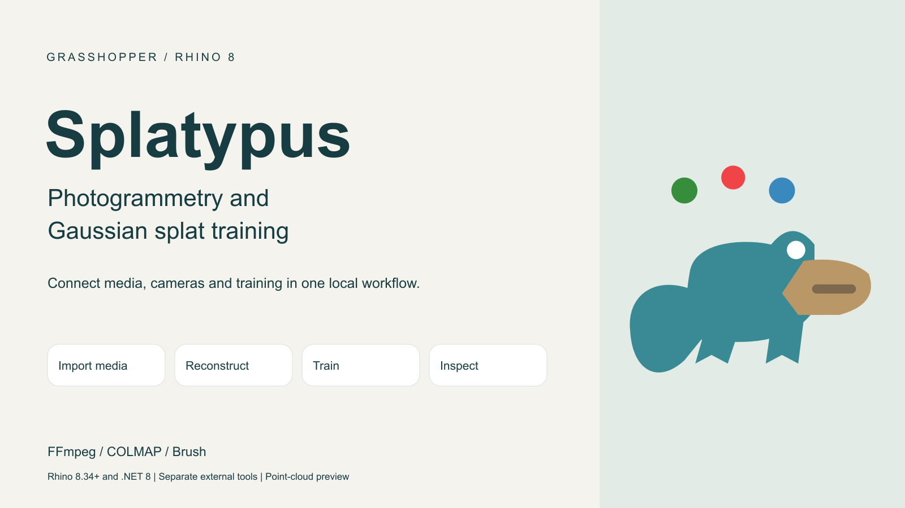
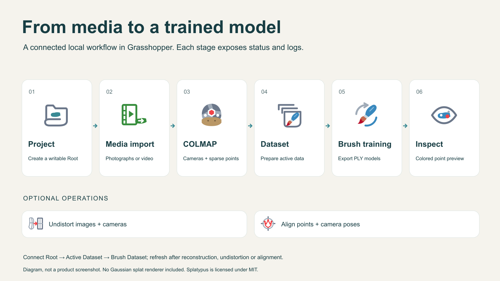

# Splatypus

**Photogrammetry and Gaussian splat training workflows for Grasshopper in Rhino 8.**

[food4Rhino](https://www.food4rhino.com/en/app/splatypus) · [Download 0.2.0](#download-and-install) · [All releases](https://github.com/Zemi-jpg/Splatypus/releases) · [User guide](Documentation/User-guide.md) · [Quick-start PDF](Publication/Splatypus-Quick-Start.pdf)



Splatypus connects **FFmpeg** media import, **COLMAP** camera reconstruction and **Brush** Gaussian splat training through a shared local project, with progress, logs and cancellation inside Grasshopper. Inspect and align reconstructions, replay video camera tracks, or capture a Rhino scene with design geometry for retraining.

Developed by **[Zeming Li](https://zeming.li/)**. Free under the **[MIT License](LICENSE.txt)**. Latest version: **[0.2.0](https://github.com/Zemi-jpg/Splatypus/releases/tag/v0.2.0)**. The original **[0.1.0](https://github.com/Zemi-jpg/Splatypus/releases/tag/v0.1.0)** release remains available with its original source tag and installers.

## What's new in 0.2.0

- **Quick Align:** align a reconstruction to Rhino geometry with three point pairs, then refine or reset it.
- **Video Frames and Video Playback:** group extracted frames by source video and animate the Rhino camera, with seeking, speed, looping and smoothing.
- **View Capture:** capture the visible Rhino scene from known camera frames and prepare calibrated images for Brush without reconstructing cameras again.
- **Auto Background:** estimate and preview a solid or gradient backdrop from splat colors.
- **Import and processing controls:** JPEG/PNG import, near-duplicate video frame filtering, COLMAP matching choices, feature extraction limits and Brush training limits.
- **Alignment handoff:** combine Quick Align and Geometry Translator adjustments in one saved camera-model alignment.

See the [short update log](Publication/Update-log-0.2.0.md) and [changelog](CHANGELOG.md).

## Download and install

| Version | Platform | Manual ZIP | Local Yak package |
| --- | --- | --- | --- |
| **0.2.0 - latest** | Windows x64 | [Download ZIP](https://github.com/Zemi-jpg/Splatypus/releases/download/v0.2.0/Splatypus-0.2.0-windows.zip) | [Download Yak](https://github.com/Zemi-jpg/Splatypus/releases/download/v0.2.0/splatypus-0.2.0-rh8_34-win.yak) |
| **0.2.0 - latest** | macOS | [Download ZIP](https://github.com/Zemi-jpg/Splatypus/releases/download/v0.2.0/Splatypus-0.2.0-macos.zip) | [Download Yak](https://github.com/Zemi-jpg/Splatypus/releases/download/v0.2.0/splatypus-0.2.0-rh8_34-mac.yak) |
| 0.1.0 | Windows x64 | [Download ZIP](https://github.com/Zemi-jpg/Splatypus/releases/download/v0.1.0/Splatypus-0.1.0-windows.zip) | [Download Yak](https://github.com/Zemi-jpg/Splatypus/releases/download/v0.1.0/splatypus-0.1.0-rh8_34-win.yak) |
| 0.1.0 | macOS | [Download ZIP](https://github.com/Zemi-jpg/Splatypus/releases/download/v0.1.0/Splatypus-0.1.0-macos.zip) | [Download Yak](https://github.com/Zemi-jpg/Splatypus/releases/download/v0.1.0/splatypus-0.1.0-rh8_34-mac.yak) |

Each release has its own **SHA256SUMS.txt**: [0.2.0 checksums](https://github.com/Zemi-jpg/Splatypus/releases/download/v0.2.0/SHA256SUMS.txt), [0.1.0 checksums](https://github.com/Zemi-jpg/Splatypus/releases/download/v0.1.0/SHA256SUMS.txt). Each installer includes the matched plugin and Core library, complete README manual, quick-start PDF and `Examples/Splatypus_Workflow.gh`. Version 0.2.0 includes the SP_020 working template, using the same package layout as 0.1.0.

**Manual ZIP:** extract the archive for your platform. In Grasshopper, open **File → Special Folders → Components Folder**, close Rhino, and copy the extracted contents into a `Splatypus` subfolder. Keep **Splatypus.gha** and **Splatypus.Core.dll** together. Restart Rhino, place **SP Hello**, and check that Status reports `SP is loaded: Ready`. Keep one installed copy and save your working definitions outside the installation folder.

**Local Yak:** install the matching downloaded package using Rhino's Yak CLI, then restart Rhino. These GitHub downloads do not by themselves register a package in the public Rhino Package Manager catalog. See [installation](Documentation/Installation.md).

## Requirements

| Requirement | Details |
| --- | --- |
| Rhino | **8.34.26223.11001 or newer**, Grasshopper and **.NET 8** |
| Windows | x64; primary release target |
| macOS | Separate build; automatic tool installation supports **Apple Silicon** |
| External tools | FFmpeg with ffprobe, COLMAP and Brush, installed separately |
| Training | Compatible GPU for Brush; CPU COLMAP does not make Brush a CPU trainer |

Rhino 7 and .NET Framework mode are unsupported. Automatic tool installation does not support Intel Mac or Windows ARM. Both release targets compile and the archives are verified; native macOS testing of the new interactive workflows remains outstanding. See the [validation report](Publication/Validation-report.md) for test scope.

Splat Preview displays colored point centers. A Gaussian splat viewport renderer, mesh reconstruction and texture-atlas generation are not included in the installable packages. Experimental mesh source is retained in the repository and excluded from release builds.

## First workflow



1. **Set up:** create a project with SP Project and install or locate external tools.
2. **Import:** run SP Media Import on photographs or video; inspect the extracted images.
3. **Reconstruct:** run SP COLMAP Pipeline or the individual stages.
4. **Align:** inspect sparse points and cameras; optionally undistort, use Quick Align and fine adjustments, then write the aligned model.
5. **Train:** connect Active Dataset to Brush Dataset, optionally supply the aligned sparse model override, prepare and run Brush Train.
6. **Inspect or recapture:** inspect a PLY, replay video cameras, or capture a visible Rhino scene for a new training dataset.

Open the included [SP_020 working template](Examples/Splatypus_Workflow.gh) with the solver disabled. Set your own project folder, media and executable paths, review saved controls, then run each stage deliberately. See the [example notes](Examples/README.md) and [user guide](Documentation/User-guide.md) for exact wiring.

## Components

Version 0.2.0 has **25 visible components** across six toolbar groups. The retained Model Report component is hidden from the toolbar; 26 icons are embedded in the plugin.

| Group | Components |
| --- | --- |
| 01 Setup | Download Tools, Hello, Project |
| 02 dataset | FFmpeg Setup, Media Import |
| 03 COLMAP | Export Model, Feature Extract, Match, Pipeline, Setup, Sparse Reconstruct, Undistort Images |
| 04 Realignment | Align COLMAP Model, Camera Planes, Geometry Translator, Quick Align, Sparse Point Cloud |
| 05 Training | Active Dataset, Brush Dataset, Brush Train |
| 06 Preview | Auto Background, Splat Preview, Video Frames, Video Playback, View Capture |

[Component inventory](Publication/assets/component-inventory.json) · [Toolbar details](Toolbar-order.md)

## Source code and documentation

The repository includes the plugin and Core source, build scripts, tests, component artwork, documentation, working example and versioned packages. Browse the complete source for **[v0.2.0](https://github.com/Zemi-jpg/Splatypus/tree/v0.2.0)** or **[v0.1.0](https://github.com/Zemi-jpg/Splatypus/tree/v0.1.0)**. GitHub Releases also provides a source ZIP and tarball for each tag.

Build with the **.NET 8 SDK**:

```powershell
dotnet build RhinoSplat.Grasshopper.csproj -c Release
dotnet build RhinoSplat.Grasshopper.Mac.csproj -c Release
```

The projects pin the Rhino 8.34 SDK through NuGet. External tool binaries and Rhino host assemblies are not bundled. See the [development guide](Documentation/Development.md) for tests, native checks and packaging.

- [User guide](Documentation/User-guide.md) - media import, alignment, training, playback and capture.
- [Quick-start PDF](Publication/Splatypus-Quick-Start.pdf) - installation and a shorter workflow walkthrough.
- [Troubleshooting](Documentation/Troubleshooting.md) and [privacy](Documentation/Privacy.md).
- [Quick alignment](Quick-alignment.md), [video playback](Video-playback.md), [viewport capture](Viewport-capture.md) and [automatic backgrounds](Auto-background.md).

For support, [open an issue](https://github.com/Zemi-jpg/Splatypus/issues) or email **[lizeming2021@gmail.com](mailto:lizeming2021@gmail.com)**. Include versions, steps to reproduce and a short log excerpt with personal paths removed.

## Licenses and credits

Copyright © 2026 **Zeming Li**. Splatypus and the included example use the [MIT License](LICENSE.txt). See [NOTICE.txt](NOTICE.txt) and [third-party notices](THIRD-PARTY-NOTICES.md).

[FFmpeg](https://ffmpeg.org/), [COLMAP](https://colmap.github.io/) and [Brush](https://github.com/ArthurBrussee/brush) are separate projects with their own licenses. Rhino, Grasshopper and food4Rhino are McNeel products and services; references describe interoperability and imply no endorsement.
